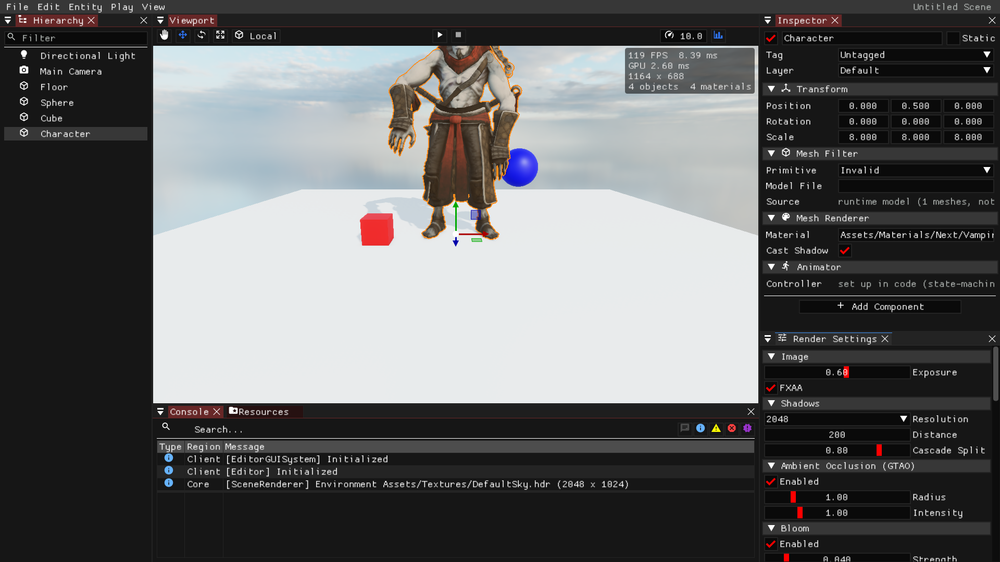
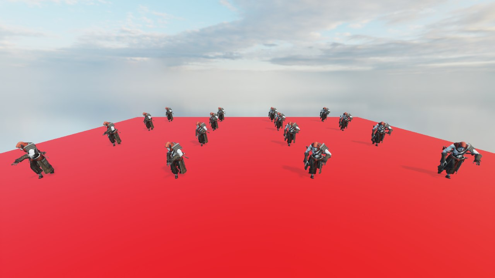
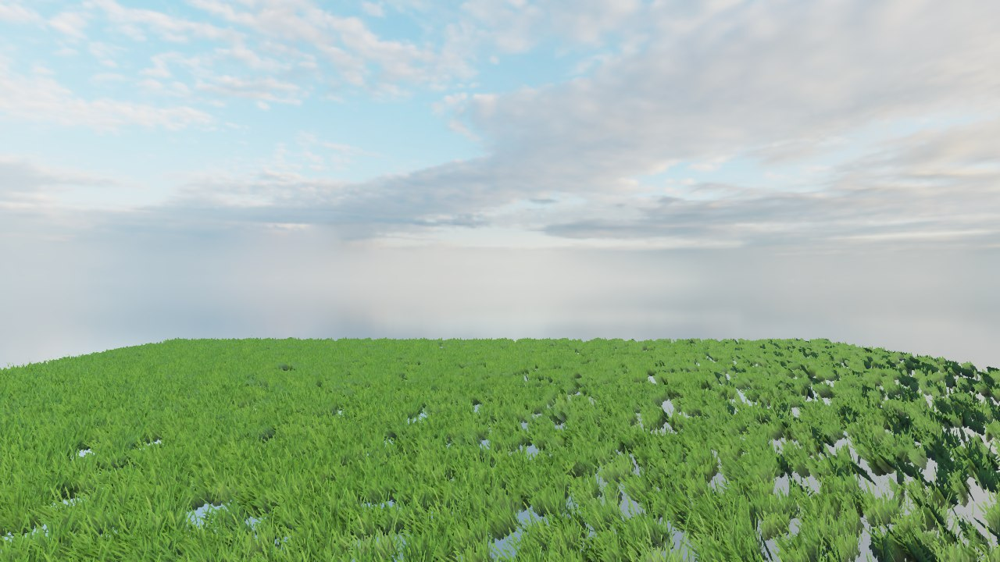
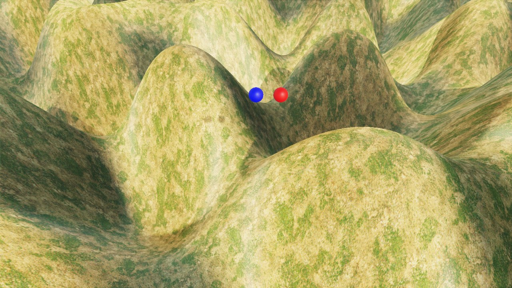
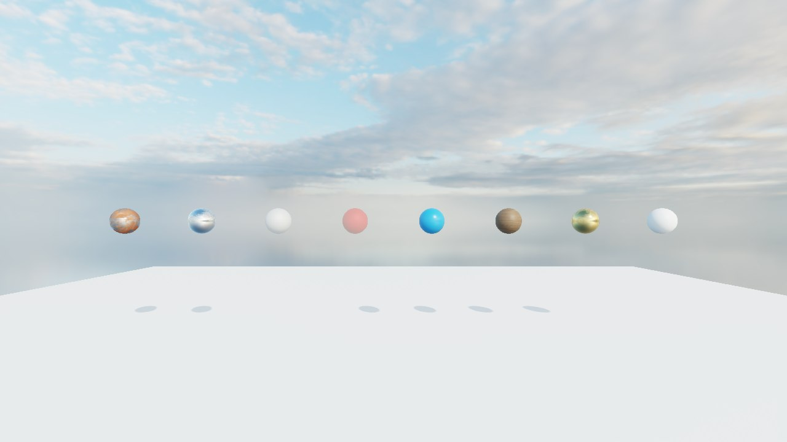

# SnowLeopardEngine

<h4 align="center">
  Yet another game engine group project.
</h4>

<p align="center">
    <a href="https://github.com/SnowLeopardEngine/SnowLeopardEngine/actions" alt="CI-Windows">
        </a>
    <a href="https://github.com/SnowLeopardEngine/SnowLeopardEngine/actions" alt="CI-Linux">
        </a>
    <a href="https://github.com/SnowLeopardEngine/SnowLeopardEngine/issues" alt="GitHub Issues">
        
    </a>
    <a href="https://github.com/SnowLeopardEngine/SnowLeopardEngine/blob/main/LICENSE" alt="GitHub">
        
    </a>
</p>



This project is a group project of COMP5530M (23/24 Group Project, 37449), University of Leeds. Since 2026 it is
being revived and modernized: the OpenGL renderer was replaced by a GPU-driven Vulkan renderer, PhysX by Jolt, GLFW by
SDL3, and the editor was rebuilt on top of them. Progress and design decisions are tracked in
[UPGRADE_PLAN.md](UPGRADE_PLAN.md).

The showcase video below shows the original 2024 version (OpenGL):

[](https://www.youtube.com/watch?v=z9oA2pugC6s)

Group Members:

| Name         | Responsibility                                                       |
| ------------ | -------------------------------------------------------------------- |
| [Kexuan Zhang](https://zzxzzk115.github.io/) | Leader. Architecture, Core Systems, Rendering, Editor, Audio, Report |
| Ziyu Min     | Associate Leader. Rendering, Shaders, Report                         |
| Jubiao Lin   | Physics, In-Game GUI, Poster                                         |
| [Simiao Wang](https://wangsimiao2000.github.io/)  | Physics, Poster, Showcase Video                                      |
| Ruofan He    | GamePlay (Path-Finding)                                              |
| [Haodong Lin](https://leolanger.github.io/)  | Animation                                                            |
| Yanni Ma     | Editor                                                               |

## Features

**Rendering** (Vulkan through [VRI](https://github.com/zzxzzk115/vri), Slang shaders)
- GPU-driven scene renderer: every mesh in one vertex / index arena, materials in one buffer with bindless textures,
  compute frustum culling and one indirect draw per pass, however many objects there are
- Render graph that derives every barrier, culls unused passes and aliases transient resources
- Deferred PBR with image-based lighting (prefiltered environment, irradiance, BRDF LUT) and a sky from an HDR map
- Cascaded shadow maps with PCF and cascade blending
- Render queues: opaque, alpha-tested foliage (two-sided, wind, GPU-culled, thousands of grass blades share one mesh)
  and sorted transparent
- Post-processing: ground-truth ambient occlusion (GTAO), physically based bloom, ACES tone mapping, FXAA 3.11
- In-game UI in one batch, text from an SDF font atlas (FreeType)
- Unity-like shader files (DzShader: properties, sub-shaders, passes, render states) compiled from Slang
- GPU timings of every render-graph pass (timestamp queries), shown in the editor and sent to Tracy

**Engine**
- Entity-component scenes (EnTT) with a parent / child hierarchy, saved and loaded as `.dzscene` files (cereal)
- Jolt Physics: rigid bodies, sphere / box / capsule / convex-mesh / height-field colliders, character controller,
  triggers, ray casts
- Skeletal animation (ozz-animation) with an animator controller: clips, transitions, parameters
- 3D audio (miniaudio)
- SDL3 windowing and input: keyboard, mouse, gamepads, high-DPI
- Native C++ scripts; C# (.NET 8) scripting host in progress
- Headless "offline" mode: hidden window, no swapchain (tests, frame captures, CI)

**Editor**
- Docked Viewport, Hierarchy, Inspector, Render Settings, Resources and Console panels
- Click to pick objects (GPU entity-id buffer), with a selection outline; move / rotate / scale gizmos with snapping
- Hierarchy with multi-select, drag-to-parent, rename, duplicate, delete and a filter
- Inspector with add / remove component and drag-and-drop of asset paths
- New / open / save scenes; Play / Pause / Stop runs a copy of the scene, so edits made while playing are discarded
- Live renderer settings, statistics and per-pass GPU times

## Gallery

| | |
|---|---|
|  Animated characters, cascaded shadows |  Alpha-tested grass with wind |
|  Jolt rigid bodies on a height-field terrain |  PBR materials under image-based lighting |

## Prerequisites

A GPU and driver with **Vulkan 1.3** support (on macOS through MoltenVK). Debug builds turn the Vulkan validation
layers on when they are installed (Vulkan SDK); they are optional.

### Windows

- [XMake](https://github.com/xmake-io/xmake) 3.1 or above
- Visual Studio 2022 or above with the C++ Desktop Development workload
- Git
- .NET 8 SDK (for the C# bindings)

> Avoid the long-path limit (PowerShell as administrator):
> ```powershell
> New-ItemProperty -Path "HKLM:\SYSTEM\CurrentControlSet\Control\FileSystem" -Name "LongPathsEnabled" -Value 1 -PropertyType DWORD -Force
> git config --system core.longpaths true
> ```

Install the .NET 8 SDK through winget:

```bat
winget install Microsoft.DotNet.SDK.8
```

### Linux

- [XMake](https://github.com/xmake-io/xmake) 3.1 or above
- GCC or Clang with C++20 support
- Git
- .NET 8 SDK

On Ubuntu / Debian, install XMake and the development packages SDL3 is built against:

```bash
bash <(curl -fsSL https://xmake.io/shget.text)

sudo apt-get install build-essential cmake git clang pkg-config libx11-dev libxext-dev libxrandr-dev \
    libxrender-dev libxinerama-dev libxcursor-dev libxi-dev libxss-dev libxfixes-dev libxtst-dev \
    libxkbcommon-dev libwayland-dev wayland-protocols libdecor-0-dev libegl1-mesa-dev libgl1-mesa-dev \
    libglvnd-dev libasound2-dev libpulse-dev libudev-dev libdbus-1-dev
```

The .NET 8 SDK is available from [Microsoft](https://dotnet.microsoft.com/download/dotnet/8.0) or your package
manager.

Linux builds are checked by CI; running on Linux has not been tested since the move to Vulkan.

### macOS

- [XMake](https://github.com/xmake-io/xmake) 3.1 or above (`brew install xmake`)
- Xcode 15 or above
- Git
- .NET 8 SDK ([installer](https://dotnet.microsoft.com/download/dotnet/8.0))
- The [Vulkan SDK](https://vulkan.lunarg.com/sdk/home#mac) (MoltenVK)

VRI runs on macOS through MoltenVK, and also has a native Metal backend. The other dependencies all support macOS.
The engine has not been built on macOS since the move to VRI yet, and there is no macOS CI job.

## Build

```bash
git clone git@github.com:SnowLeopardEngine/SnowLeopardEngine.git --recursive
cd SnowLeopardEngine
```

**Windows**

```powershell
./build.bat
```

**Linux / macOS**

```bash
./build.sh
```

The scripts build the C# bindings, update the package repository and build everything with xmake (debug by default;
`xmake f -m release` switches to release). The first build downloads and compiles all third-party packages.

## Run

The editor opens the example project by default:

```bash
xmake run SnowLeopardEditor
```

| Viewport control | Action |
|---|---|
| Right mouse + move, W A S D / Q E | Look around and fly (Shift: faster; wheel: fly speed) |
| Middle mouse (or left with the hand tool) | Pan |
| Alt + left mouse | Orbit |
| Wheel | Dolly |
| Left click | Select (Ctrl / Shift: add or remove) |
| Q / W / E / R, T | Hand / move / rotate / scale tool, local / world space (Ctrl: snap) |
| F | Frame the selection |
| Ctrl+S, Ctrl+O, Ctrl+N | Save, open, new scene |
| Ctrl+D, Del, Ctrl+P | Duplicate, delete, play / stop |

Examples (`xmake run <name>`): `RenderingSystem-Overview`, `RenderingSystem-PBR`, `RenderingSystem-Instancing`,
`OverallShowcase`, `PhysicsSystem`, `AnimationSystem`, `GUISystem`, `AudioSystem`, `InputSystem`, `NativeScripting`,
`LifeTimeComponents`, `Application`, and the game `GameDemo`.

Engine tests (`xmake run <name>`): `SceneRendering`, `RenderGraph`, `DzShader`, `SceneSerialization`,
`PhysicsScenarios`, `AnimationPlayback`, `InputEvents`. They need a Vulkan GPU and open no window; each check prints
PASS / FAIL and the exit code is the number of failures.

Any app runs headless with `SLE_OFFLINE=1`; `SLE_CAPTURE_FRAME=<n>` and `SLE_CAPTURE_PATH=<file.png>` save the n-th
frame, and `SLE_OFFLINE_SIZE=<width>x<height>` sets the size it is rendered at (the screenshots above were made this
way).

## 3rd Party Libraries

| Library | Use |
|---|---|
| [VRI](https://github.com/zzxzzk115/vri) | Rendering hardware interface (Vulkan), ImGui renderer |
| [Slang](https://github.com/shader-slang/slang) | Shader language and compiler |
| [SDL3](https://github.com/libsdl-org/SDL) | Window, input, file dialogs |
| [Jolt Physics](https://github.com/jrouwe/JoltPhysics) | Physics |
| [ozz-animation](https://github.com/guillaumeblanc/ozz-animation) | Skeletal animation |
| [miniaudio](https://github.com/mackron/miniaudio) | Audio |
| [EnTT](https://github.com/skypjack/entt) | Entity-component system |
| [cereal](https://github.com/USCiLab/cereal) | Serialization |
| [Dear ImGui](https://github.com/ocornut/imgui) (docking) | Editor UI |
| [ImGuizmo](https://github.com/CedricGuillemet/ImGuizmo) | Editor gizmos |
| [assimp](https://github.com/assimp/assimp) | Model import |
| [stb](https://github.com/nothings/stb) | Images |
| [FreeType](https://freetype.org/) | Font rasterization (SDF atlas) |
| [glm](https://github.com/g-truc/glm) | Math |
| [spdlog](https://github.com/gabime/spdlog), [fmt](https://github.com/fmtlib/fmt) | Logging, formatting |
| [Tracy](https://github.com/wolfpld/tracy) | Profiler |
| [magic_enum](https://github.com/Neargye/magic_enum) | Enum reflection |
| [Coral](https://github.com/StudioCherno/Coral) | .NET host for C# scripting |
| [argparse](https://github.com/p-ranav/argparse) | Command line |

## References

- The render graph and the GPU profiler are ported from [libvultra](https://github.com/zzxzzk115/libvultra).
- Jimenez et al., *Practical Real-Time Strategies for Accurate Indirect Occlusion* (GTAO), 2016;
  [XeGTAO](https://github.com/GameTechDev/XeGTAO).
- Jimenez, *Next Generation Post Processing in Call of Duty: Advanced Warfare* (bloom), SIGGRAPH 2014.
- Karis, *Real Shading in Unreal Engine 4* (split-sum image-based lighting), SIGGRAPH 2013.
- Lottes, *FXAA 3.11*, NVIDIA, 2011.
- Narkowicz, *ACES Filmic Tone Mapping Curve*, 2016.
- Green, *Improved Alpha-Tested Magnification for Vector Textures and Special Effects* (SDF text), SIGGRAPH 2007.

## License

This project is licensed under the [MIT](./LICENSE) license.
